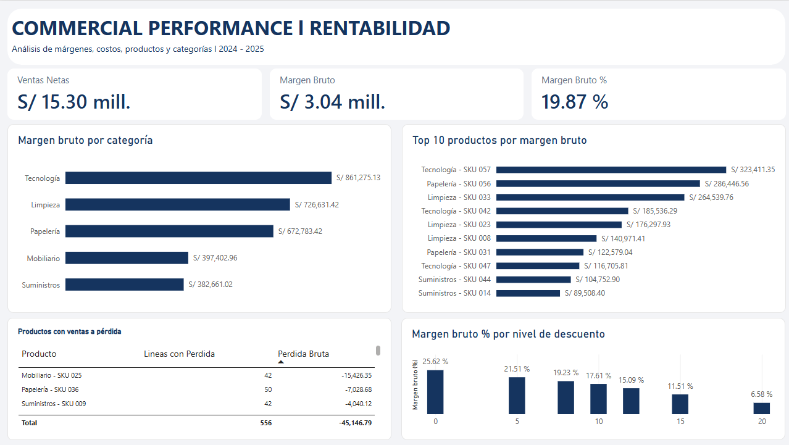
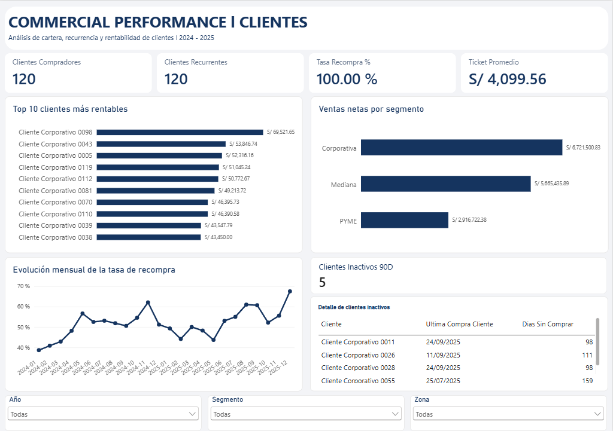

# Commercial Performance & Profitability Analytics

**Proyecto de portafolio | Inteligencia comercial B2B | SQL · Excel · Power BI**

Análisis integral del desempeño comercial de una empresa B2B ficticia durante **2024–2025**, desarrollado con datos simulados. El proyecto integra información de ventas, costos, metas, productos, vendedores y clientes para convertirla en indicadores de gestión y visualizaciones interactivas que apoyen la toma de decisiones.

**Nota:** Este es un proyecto personal de portafolio con datos simulados. Los resultados no corresponden a una empresa real.

## Objetivo de negocio

Diseñar una solución de Business Intelligence que permita responder preguntas clave:

- ¿Cómo evolucionan las ventas y el margen bruto a lo largo del tiempo?
- ¿Qué categorías, productos y vendedores generan mayor rentabilidad?
- ¿Qué tan bien se cumplen las metas comerciales?
- ¿Qué segmentos concentran los ingresos?
- ¿Qué clientes muestran recurrencia y cuáles presentan inactividad?

## Tecnologías utilizadas

| Herramienta | Aplicación en el proyecto |
|---|---|
| **PostgreSQL / SQL** | Consultas de integración, análisis comercial, rentabilidad y validaciones. |
| **Microsoft Excel** | Verificación de indicadores y conciliaciones financieras. |
| **Power Query** | Preparación de datos y ajustes de tipos. |
| **Power BI** | Modelo relacional, medidas DAX, segmentadores y dashboards interactivos. |
| **DAX** | Cálculo de ventas, márgenes, cumplimiento de metas, recompra e inactividad. |

## Dashboard interactivo

El informe tiene **cuatro páginas**. Las capturas siguientes muestran el resultado desarrollado en Power BI.

### 1. Resumen Ejecutivo

Indicadores generales de ventas, margen bruto, cumplimiento comercial y pedidos, junto con la evolución mensual de ventas y el ranking de vendedores.

### 2. Rentabilidad

Análisis de margen bruto por categoría y producto, identificación de operaciones con margen negativo y comparación del margen porcentual según el nivel de descuento.

### 3. Desempeño comercial

Comparación de ventas frente a metas, cumplimiento y margen bruto por vendedor, con una tabla de indicadores por ejecutivo.

### 4. Clientes

Análisis de compradores, recurrencia mensual, ventas por segmento, clientes rentables y clientes sin compras durante al menos 90 días.

## Principales KPI | 2024–2025

| Indicador | Resultado |
|---|---:|
| Ventas netas | **S/ 15,303,659.10** |
| Costos totales | **S/ 12,262,905.15** |
| Margen bruto | **S/ 3,040,753.95** |
| Margen bruto (%) | **19.87%** |
| Cumplimiento de metas | **162.91%** |
| Pedidos distintos | **3,733** |
| Líneas de ventas | **11,147** |
| Clientes compradores | **120** |

## Hallazgos del análisis

1. **Concentración por segmento.** Los clientes de los segmentos Corporativa y Mediana representan aproximadamente **80.9% de las ventas netas**. Esto sugiere monitorear la concentración comercial y la dependencia de segmentos específicos.

2. **Desempeño de vendedores.** El **Ejecutivo Comercial 06** lidera las ventas acumuladas, con aproximadamente **S/ 2.11 millones**. El análisis permite comparar volumen, cumplimiento y rentabilidad, no solo ventas.

3. **Rentabilidad y operaciones con pérdida.** Se identificaron **S/ 45,146.79** de margen bruto negativo agregado en líneas con pérdida. Estas operaciones son candidatas para revisar precios, descuentos y costos.

4. **Cumplimiento de metas.** El cumplimiento agregado fue **162.91%**, lo que justifica revisar cómo se definieron las metas y si reflejan adecuadamente el potencial comercial.

5. **Comportamiento de clientes.** Al cierre de 2025 se identificaron **5 clientes inactivos durante al menos 90 días**, según la definición implementada, como punto de partida para posibles acciones de recuperación.

Estas observaciones describen un conjunto de **datos simulados**. Las acciones sugeridas son hipótesis de gestión y no pruebas de causalidad.

## Metodología

1. **Comprensión del negocio:** definición de preguntas comerciales y KPI prioritarios.
2. **Análisis con SQL:** consultas para integrar y estudiar ventas, rentabilidad, metas, productos y clientes.
3. **Validación con Excel:** revisión de importes, conteos y conciliación financiera.
4. **Modelado en Power BI:** relaciones entre tablas de hechos y dimensiones, medidas DAX y filtros por periodo y entidades comerciales.
5. **Visualización:** construcción de cuatro páginas orientadas al análisis ejecutivo y comercial.
6. **Control de calidad:** comprobación de registros, duplicados de identificadores, valores nulos en campos esenciales y conciliación de indicadores.

## Validaciones de calidad

| Control | Resultado |
|---|---:|
| Líneas de ventas verificadas entre SQL, Excel y Power BI | **11,147** |
| Identificadores `linea_id` duplicados | **0** |
| Filas con nulos en los campos esenciales evaluados | **0** |
| Diferencia `Ventas Netas − Costos Totales − Margen Bruto` | **S/ 0.00** |

La conciliación financiera también se comprobó por separado para **2024 y 2025**. Los conteos y validaciones señalados no sustituyen una auditoría integral de todos los campos y reglas de negocio.

**Definiciones relevantes:**

- **Margen bruto (%)** = Margen bruto / Ventas netas.
- **Cumplimiento de metas (%)** = Ventas netas / Meta de ventas.
- **Cliente recurrente** = Cliente con dos o más `pedido_id` distintos dentro del contexto de filtros seleccionado.
- **Tasa de recompra mensual** = Porcentaje de compradores con dos o más pedidos distintos en el mismo mes. **No equivale a retención entre meses.**
- **Cliente inactivo (90 días)** = Cliente con una compra anterior, pero sin compras durante al menos 90 días al cierre del periodo analizado.

## Estructura del repositorio

- [SQL/](SQL/) — Consultas SQL de integración, análisis, desempeño y validaciones.
- [EXCEL/](EXCEL/) — Archivos de control y conciliación utilizados en el análisis.
- [POWERBI/](POWERBI/) — Archivo `.pbix` con los cuatro dashboards y sus medidas.
- [IMAGENES/](IMAGENES/) — Capturas de las cuatro páginas del informe.
- [README.md](README.md) — Presentación del caso de estudio.

Para explorar el informe de forma interactiva, descarga el archivo `.pbix` desde `POWERBI/` y ábrelo con **Power BI Desktop**. La actualización de orígenes de datos puede requerir configurar conexiones locales; el repositorio no garantiza una reproducción automática del dataset simulado original.

## Conclusión

Este proyecto ejemplifica un flujo de análisis comercial B2B, desde las consultas y validaciones hasta la construcción de un dashboard gerencial. Permite evaluar simultáneamente ingresos, rentabilidad, desempeño de vendedores y comportamiento de clientes, en lugar de analizar únicamente el volumen de ventas.

**Autor:** Arian Pereyra  
**Enfoque:** Business Intelligence · Inteligencia Comercial · Análisis de Datos

